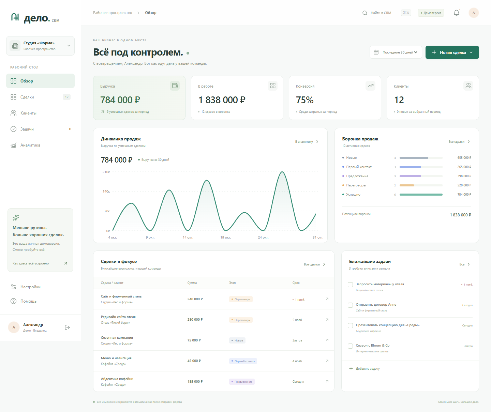
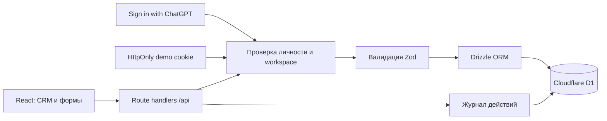

# Дело CRM

Небольшая CRM для студий, агентств и сервисного бизнеса: контакты, сделки, следующий шаг и понятные цифры в одном рабочем пространстве.

**Демо:** https://delo-mini-crm-portfolio.cheekyolm65.chatgpt.site

Нажмите **«Попробовать демо»**: приложение создаст личную песочницу с 12 клиентами, 20 сделками и 5 задачами. Пароль и регистрация не нужны. Все компании и контакты вымышлены; изменения одного посетителя не видны другим. Демоверсия доступна 7 дней в этом браузере; выход удаляет её. Для постоянного личного пространства предусмотрен вход с ChatGPT.



## Задача продукта

Предпринимателю нужно помнить, кому обещал предложение, какие сделки требуют внимания и сколько продаж завершено. Дело CRM собирает эту информацию без сложной настройки. Пример сценария: добавить клиента → создать сделку → назначить следующий шаг → продвинуть по воронке → закрыть сделку → увидеть результат в аналитике.

## Возможности

- Авторизация через ChatGPT; отдельное рабочее пространство владельца.
- Личный демоаккаунт без пароля, с готовыми данными и восстановлением примеров.
- Создание, просмотр, редактирование и удаление клиентов, контакты, источник и заметки.
- Карточки сделок с суммой, клиентом, датой, этапом и следующим шагом.
- Канбан с перетаскиванием, представление списком, активные и закрытые сделки.
- Задачи со сроками, связью со сделкой, просрочками и отметкой выполнения.
- Поиск клиентов и сделок, фильтры и экспорт CSV.
- Выручка, конверсия, средний чек, взвешенный прогноз, источники продаж и план на месяц.
- Журнал действий, подтверждение удаления, обработка ошибок и мобильная вёрстка.

## Стек

| Слой | Технологии |
| --- | --- |
| Интерфейс | React 19, TypeScript, CSS / Tailwind CSS 4, Lucide |
| Графики и диалоги | Recharts, Radix UI |
| Fullstack-фреймворк | Vinext: Next.js App Router API поверх Vite |
| Сервер | Cloudflare Workers, Web Request / Response |
| Данные | Cloudflare D1 (SQLite), Drizzle ORM, SQL-миграции |
| Валидация | Zod на клиенте и сервере |
| Постоянная авторизация | Sign in with ChatGPT, интеграция Sites |
| Демо | Случайный токен, SHA-256 в БД, HttpOnly cookie, срок 7 дней |
| Тестирование | Node Test Runner, HTTP-тесты на Python, Playwright |
| Сборка и размещение | Vite, Sites / Cloudflare Workers |

Версии закреплены в `package-lock.json`. Проект использует поставляемый Sites шаблон Vinext `1.0.0-beta.5`; это осознанная зависимость от текущего шаблона хостинга. При переносе на другой хостинг потребуются замена интеграции входа, D1 binding и конфигурации Worker.

## Архитектура



Бизнес-записи содержат `workspace_id`. Идентификатор пространства определяется сервером по подтверждённой личности или демосессии. API не принимает его от клиента. При изменении записи проверяются и её ID, и принадлежность пространству. Связанный клиент или сделка также проходят проверку принадлежности.

Изменения записи и запись события выполняются одной D1 batch-транзакцией. Удаление клиента каскадно удаляет его сделки; связанные задачи сохраняются со сброшенной ссылкой на сделку. Демоданные заполняются вне schema-миграций; большие вставки разделены с учётом лимита D1 на параметры запроса.

Схема: `workspaces`, `demo_sessions`, `clients`, `deals`, `tasks`, `activities`. Подробнее — [архитектура и решения](docs/architecture.md).

## Как считаются показатели

- **Выручка:** сумма успешных сделок по дате закрытия за выбранный период, включая весь текущий день по Москве.
- **В работе:** текущие сделки, кроме успешных и закрытых без сделки. Эта метрика не ограничивается периодом.
- **Конверсия:** успешные / (успешные + закрытые без сделки) за период.
- **Средний чек:** выручка / количество успешных сделок за период.
- **Прогноз:** сумма активных сделок × вероятность этапа: 10%, 25%, 50%, 75%.
- **План на месяц:** выручка текущего календарного месяца / цель из настроек.

Возврат успешной сделки в работу очищает дату закрытия и исключает её из выручки. Повторное закрытие назначает новую дату. Все суммы хранятся целым количеством рублей; дробные значения не принимаются. Для настоящего платёжного учёта следует перейти к хранению копеек.

## Локальный запуск

Нужны Node.js **22.13+**, npm и Git. В Windows используйте PowerShell; Bash не требуется.

```bash
npm ci
npm run build
node --import ./scripts/sites-env.mjs ./node_modules/wrangler/bin/wrangler.js d1 execute DB --local --config dist/server/wrangler.json --persist-to .wrangler/state --file drizzle/0000_sturdy_masque.sql
npm run dev
```

Откройте http://127.0.0.1:5173 и нажмите «Попробовать демо». Миграцию применяют **один раз** к новой локальной базе. `npm run build` перед миграцией создаёт `dist/server/wrangler.json`. Данные локальной и опубликованной версии независимы.

Кнопка «Войти с ChatGPT» в локальном dev-режиме использует встроенную в шаблон имитацию пользователя `seedy@sites.test`. В опубликованной версии вход обслуживает платформа; имитация в production не включается.

Для изменения схемы отредактируйте `db/schema.ts`, выполните `npm run db:generate`, проверьте новый SQL, соберите проект и примените только новые миграции. Не редактируйте уже применённые миграции.

## Проверки

```bash
npm run typecheck
npm test
```

С запущенным `npm run dev`:

```bash
npm run test:api
python -m pip install -r requirements-dev.txt
python -m playwright install chromium
npm run test:e2e
```

HTTP-проверки покрывают CRUD, изоляцию двух демосессий, запрет чужих связей, смену этапов, каскады, настройки, сброс и выход. Playwright проходит основные сценарии на desktop и mobile и сохраняет скриншоты в `docs/screenshots`. Тесты интеграции разрешены только на loopback-адресах и создают отдельные временные песочницы.

GitHub Actions выполняет TypeScript, модульные тесты и сборку. Полный браузерный сценарий запускается локально отдельно. Фактические результаты зафиксированы в [проверках](docs/verification.md).

## API

| Метод и путь | Действие |
| --- | --- |
| `GET /api/session` | Текущая сессия |
| `POST /api/session` | Личное демо, тело `{"action":"demo"}` |
| `DELETE /api/session` | Завершить демосессию и удалить её пространство |
| `GET /api/crm/bootstrap` | Данные текущего пространства |
| `POST /api/crm/clients`, `/deals`, `/tasks` | Создать запись |
| `PATCH /api/crm/clients/:id`, `/deals/:id`, `/tasks/:id` | Изменить запись |
| `DELETE /api/crm/clients/:id`, `/deals/:id`, `/tasks/:id` | Удалить запись |
| `PATCH /api/crm/settings` | Название пространства и план продаж |
| `POST /api/crm/reset` | Восстановить примеры, только для демо |

Каждый изменяющий запрос должен иметь JSON Content-Type и same-origin заголовок Origin. Сервер возвращает структурированную ошибку и соответствующий HTTP-статус; успешные ответы не кэшируются.

## Безопасность и границы MVP

- Секреты не включаются в репозиторий и клиентский bundle. Пароли приложение не хранит.
- Демотокен: 32 криптографически случайных байта; в базе хранится только SHA-256. Cookie: HttpOnly, SameSite=Lax, Secure на HTTPS.
- Истёкшие демосессии удаляются небольшими пакетами при создании новых; выход удаляет песочницу немедленно.
- Zod проверяет формы на сервере. Drizzle параметризует SQL. React выводит заметки как текст. Экспорт CSV экранирует значения и защищает от формул.
- Одно пространство принадлежит одному владельцу. Совместная работа, приглашения и роли сотрудников пока не реализованы.
- Для ограниченного MVP: максимум 500 клиентов, 1000 сделок и 500 задач на пространство, загрузка данных одним запросом. Лимит проверяется в приложении и не заменяет квоты при конкурентной нагрузке.
- Отдельного rate limiting создания анонимных песочниц, расписания очистки, мониторинга и резервного копирования в коде пока нет. Они нужны перед использованием с настоящими данными и заметным публичным трафиком.
- Это портфолио MVP; нет платежей, рассылок, импорта, внешней почтовой интеграции и полноценного финансового учёта.

## Материалы для портфолио

- [Скриншоты интерфейса](docs/screenshots)
- [Архитектура и решения](docs/architecture.md)
- [Сценарий видео на 60–90 секунд](docs/demo-script.md)
- [Что сделал Codex и что проверить самостоятельно](docs/ai-workflow.md)
- [Краткое описание проекта для резюме](docs/portfolio-case.md)

Запись демонстрации: `npm run demo:record`. Скрипт работает с локальным приложением и создаёт MP4 в `outputs/delo-crm-demo.mp4`. Видео не загружается в Git автоматически; его можно прикрепить к GitHub Release или разместить рядом с портфолио.

## Работа с AI

Codex подготовил реализацию, схему данных, UI, API, тесты и документацию и выполнил доступные проверки в рабочем окружении. Это **не означает**, что автор портфолио уже самостоятельно проверил или настроил эти части. Для честного описания личного вклада пройдите [чек-лист](docs/ai-workflow.md) и отмечайте только реально выполненное вами.
