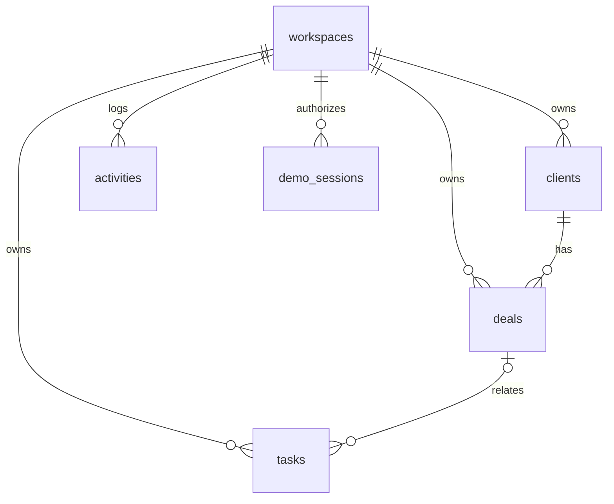

# Архитектура Дело CRM

## Структура проекта

```text
app/
  page.tsx                    серверная точка входа
  layout.tsx                  метаданные и русский язык
  crm-app.tsx                 экраны, состояние и запросы
  crm-ui.tsx                  UI-компоненты и доступные диалоги
  crm-dialogs.tsx             формы клиентов, сделок и задач
  api/session/route.ts        вход в демо и выход
  api/crm/[...path]/route.ts  CRUD и bootstrap API
  chatgpt-auth.ts             интеграция личности платформы
db/
  schema.ts                  типизированная SQL-схема
  index.ts                   D1 binding и Drizzle
lib/
  domain.ts                  типы, Zod, расчёты и даты
  server.ts                  авторизация, Origin, ошибки
  seed.ts                    демоданные и атомарный сброс
drizzle/                     SQL и метаданные миграций
tests/                       модульные, API и браузерные проверки
worker/, scripts/vite/       инфраструктура шаблона Sites
```

## Почему этот стек

React и TypeScript позволяют описывать интерфейс и контракты одними типами. Zod повторно используется в формах и API, но сервер всегда валидирует входящие данные самостоятельно. Drizzle даёт типизированные запросы и обычный SQL в репозитории. D1 и Workers позволяют развернуть API и SQL-базу рядом с приложением без отдельного сервера.

Vinext сохраняет структуру App Router, а сборку выполняет Vite. Версия из шаблона закреплена, включая её beta-статус. Это компромисс удобства интеграции с Sites; код, который зависит от платформы, собран в подключении БД, авторизации и инфраструктуре Worker. Перенос на обычный Next.js/Node с PostgreSQL потребует адаптации этих частей.

## Модель данных



В SQL есть внешние ключи и индексы по пространству. API дополнительно проверяет принадлежность связанных записей, потому что один внешний ключ `client_id` сам по себе не доказывает принадлежность пространству. В базе нет RLS: граница доступа находится в серверных обработчиках. Обход API прямым доступом к D1 не входит в модель угроз обычного посетителя.

## Личность и деморежим

Постоянный пользователь определяется по доверенным заголовкам платформы через `getChatGPTUser()`. ID, а не email, служит ключом владельца. В dev-режиме шаблон имитирует вход только на loopback.

Демопосетитель получает случайный bearer-токен в HttpOnly cookie. В базе хранится его хеш, ID песочницы и срок действия. Этот токен не является публичным тестовым паролем. Он авторизует доступ только к одной песочнице. Cookie демо имеет приоритет над постоянным входом: вошедший пользователь может открыть демо, не смешивая данные со своим аккаунтом.

## Поток изменения сделки

1. Форма отправляет JSON на `PATCH /api/crm/deals/:id`.
2. Обработчик проверяет Origin и тип содержимого.
3. Сервер определяет пространство и ищет запись с `id + workspace_id`.
4. Zod валидирует значения. Клиент сделки также проверяется в этом пространстве.
5. При переходе в `won`/`lost` назначается `closed_at`; при возврате в работу он очищается.
6. Обновление и запись события выполняются в одной batch-транзакции.
7. Клиент перечитывает актуальные данные и пересчитывает показатели.

Клиент не делает вид, что изменение сохранилось, пока не получен успешный ответ. Ошибки отображаются уведомлением. Параллельное редактирование сейчас использует правило «последняя запись побеждает»; версионирование записей — следующий шаг для командного режима.

## Следующие шаги при росте продукта

Серверная пагинация и агрегации вместо загрузки всех записей; участники пространства и роли; отдельные API-модули по сущностям; контроль версий записей; инфраструктурные квоты и rate limiting; плановая очистка демо; мониторинг и резервное копирование. Эти возможности не выдаются за готовые.
