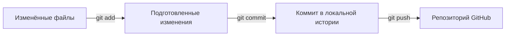

# Git в проекте Дело CRM

Git хранит историю проекта на вашем компьютере. GitHub размещает её в интернете, показывает код и README, выполняет проверки и позволяет обсуждать изменения.

Репозиторий: https://github.com/Vesel-mladshiy/delo-crm

## Что уже настроено

- Репозиторий находится в `D:\Portfolio\mini_CRM\delo-crm`.
- Основная ветка — `main`.
- Адрес GitHub подключён под именем `origin`.
- `main` отслеживает `origin/main`, поэтому достаточно команды `git push`.
- `.gitignore` исключает зависимости, локальную базу, переменные окружения, сборку и временные файлы.
- GitHub Actions проверяет TypeScript, модульные тесты и сборку при отправке изменений.

## Как изменение попадает на GitHub



`commit` фиксирует выбранные изменения локально. `push` отправляет уже созданные коммиты на GitHub. `main` — имя ветки, `origin` — короткое имя адреса удалённого репозитория.

## Пример обычного рабочего дня

Откройте PowerShell в папке проекта и посмотрите состояние:

```powershell
git status
git log --oneline -5
```

Измените, например, `app/crm-app.tsx`. Затем проверьте разницу и выполните проверки:

```powershell
git diff
npm run typecheck
npm test
npm run build
```

Если проверки прошли, добавьте нужный файл, проверьте подготовленные изменения и создайте коммит:

```powershell
git add app/crm-app.tsx
git diff --staged
git commit -m "feat: improve deal search"
git push
```

Заменяйте путь и сообщение на реальные изменённые файлы и смысл своей работы. Один коммит удобно посвящать одному законченному изменению. После `push` откройте вкладку **Actions** на GitHub и проверьте результат `CRM checks`.

Если вы меняли файлы через сайт GitHub или работали на другом компьютере, перед новой работой получите эти коммиты:

```powershell
git pull --ff-only
```

## Полезные команды

| Команда | Для чего |
| --- | --- |
| `git status` | Узнать ветку и состояние файлов |
| `git diff` | Посмотреть ещё не подготовленные изменения |
| `git diff --staged` | Посмотреть содержимое будущего коммита |
| `git log --oneline -5` | Посмотреть последние пять коммитов |
| `git remote -v` | Узнать адрес удалённого репозитория |
| `git restore --staged README.md` | Убрать файл из будущего коммита, сохранив изменения в нём |

## Репозиторий, видео и опубликованный сервис

Код и документация находятся в репозитории. Видео прикреплено к релизу `v0.1.0`, поэтому его можно открыть и скачать по публичной ссылке.

Приложение размещено отдельно в Sites / Cloudflare. GitHub Actions выполняет проверки кода. Для обновления работающего приложения нужен отдельный деплой через Sites. Это позволяет сначала проверить изменение и только затем выпустить его пользователям.
